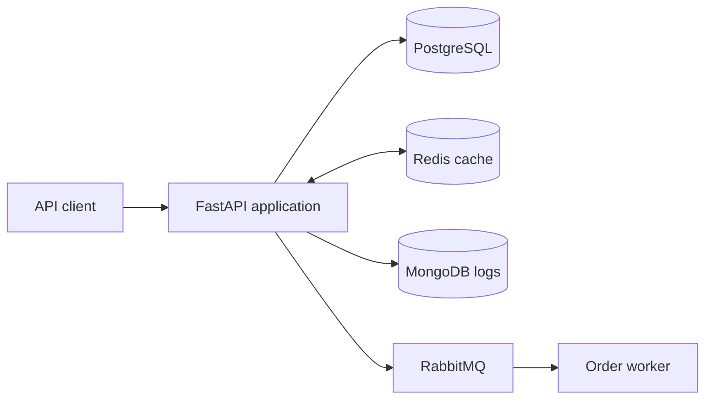

# SFMShop

[](https://github.com/vitalysss/SFMShop/actions/workflows/ci-cd.yml)

Учебный backend интернет-магазина на FastAPI. Проект показывает полный путь заказа: от JWT-аутентификации и проверки остатков до транзакционного списания средств, сброса кэша и отправки фоновых задач в RabbitMQ.

## Что реализовано

- JWT-аутентификация и защищённые API-методы;
- CRUD товаров, фильтрация, сортировка и пагинация;
- создание заказа в транзакции PostgreSQL с уровнем изоляции `SERIALIZABLE`;
- блокировка пользователя и товара через `SELECT ... FOR UPDATE` для защиты от конкурентных изменений;
- кэширование каталога и отдельных товаров в Redis с инвалидированием после изменений;
- публикация задач обработки заказа в RabbitMQ и отдельный consumer с retry и очередью ошибок;
- журналирование бизнес-событий в MongoDB;
- параллельные запросы к БД, Redis и внешнему API через `asyncio.gather`;
- миграции Alembic, Docker Compose и автоматические проверки в GitHub Actions;
- unit- и интеграционные API-тесты на `pytest`.

## Стек

`Python 3.12` · `FastAPI` · `Pydantic v2` · `SQLAlchemy 2` · `asyncpg` · `PostgreSQL` · `Alembic` · `Redis` · `RabbitMQ` · `MongoDB` · `Docker Compose` · `pytest` · `Ruff` · `mypy` · `GitHub Actions`

## Архитектура



Основное приложение и worker запускаются отдельными контейнерами. PostgreSQL хранит бизнес-данные, Redis ускоряет чтение каталога, MongoDB хранит события, а RabbitMQ отделяет фоновые операции от HTTP-запроса.

## Быстрый запуск через Docker

Требуются Docker и Docker Compose.

```bash
git clone https://github.com/vitalysss/SFMShop.git
cd SFMShop
cp .env.example .env
docker compose --env-file .env -f docker/docker-compose.yml up --build
```

После запуска:

- Swagger UI: <http://localhost:8000/docs>
- API: <http://localhost:8000>
- RabbitMQ Management: <http://localhost:15672>

Остановка контейнеров:

```bash
docker compose -f docker/docker-compose.yml down
```

## Локальный запуск

```bash
python -m venv .venv
python -m pip install -r requirements.txt
```

Активируйте виртуальное окружение, скопируйте `.env.example` в `.env`, укажите параметры подключений и выполните:

```bash
python -m alembic upgrade head
python -m uvicorn src.api.main:app --reload
```

Consumer очереди запускается отдельно:

```bash
python -m src.services.queue_consumer
```

## Основные API-методы

| Метод | Путь | Назначение |
|---|---|---|
| `POST` | `/api/v1/login` | Получить JWT |
| `GET` | `/products` | Каталог с фильтрацией, сортировкой и пагинацией |
| `POST` | `/products` | Создать товар |
| `GET` | `/products/{product_id}` | Получить товар |
| `PUT` | `/products/{product_id}` | Изменить товар |
| `DELETE` | `/products/{product_id}` | Удалить товар |
| `POST` | `/orders` | Создать заказ от имени авторизованного пользователя |
| `POST` | `/orders/process` | Обработать набор заказов |

Полная и актуальная схема доступна в Swagger UI после запуска приложения.

## Тестирование и качество кода

```bash
python -m ruff check src tests scripts
python -m mypy src --ignore-missing-imports
python -m pytest tests -q \
  --cov=src.api \
  --cov=src.models \
  --cov=src.database.models \
  --cov=src.utils \
  --cov-report=term-missing \
  --cov-fail-under=81
```

Текущий результат: **79 тестов проходят**, покрытие выбранных прикладных модулей — **около 85%**. Тесты используют фикстуры, параметризацию, моки, `AsyncMock`, временные файлы и подмену зависимостей FastAPI.

GitHub Actions при каждом push и pull request проверяет Ruff, mypy, тесты и минимальный порог покрытия 81%.

## Структура

```text
src/api/         FastAPI-приложение, маршруты, схемы и middleware
src/database/    модели, подключения и запросы к PostgreSQL
src/services/    кэш, очередь, внешние API и бизнес-сервисы
src/models/      предметные модели и паттерны проектирования
migrations/      миграции Alembic
tests/           unit- и API-тесты
docker/          Dockerfile и Docker Compose
docs/            архитектурные заметки и решения
```

## Статус проекта

Проект создан для обучения и портфолио и развивается локально. Внешний сервис отзывов в агрегирующем endpoint сейчас демонстрационный: при его недоступности API возвращает пустой список отзывов. Production-деплой и наблюдаемость вынесены в дальнейший план развития.
